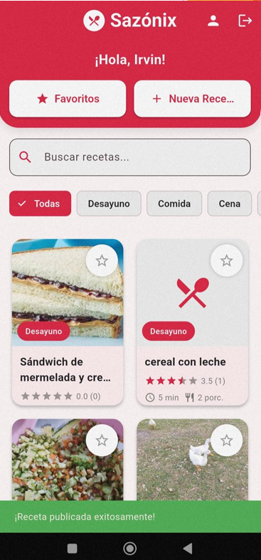
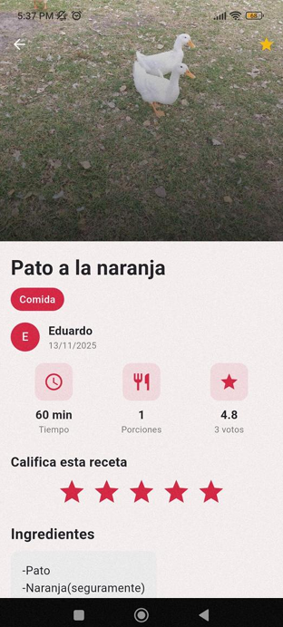
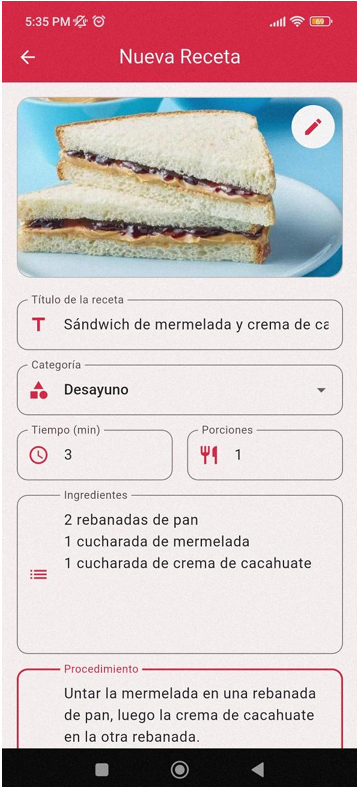
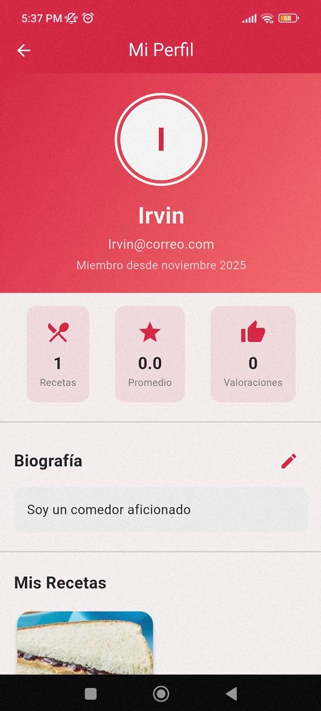

# Sazónix

An Android app for sharing cooking recipes: users publish recipes with a photo,
find them by name or category, rate and comment on them, and save their
favorites. Built with Flutter as the final project of my Mobile Development
Fundamentals course at UASLP. Everything runs on the device, with a local SQLite
database.

> The app's interface is in Spanish.

<p>
  
  
  
  
</p>

## Features

- **Accounts:** sign up, sign in and a session that persists between launches.
  Passwords are stored as salted PBKDF2 hashes, never in plain text.
- **Recipes:** title, photo from the camera or the gallery, category,
  preparation time, servings, ingredients and steps.
- **Search and filters** by name and by category (breakfast, lunch, dinner,
  dessert, drinks, snacks and vegetarian).
- **Ratings** from 1 to 5 stars, one per user and recipe, with the average
  shown on every card.
- **Comments** on each recipe.
- **Favorites** list for each user.
- **Profile** with a bio, the user's recipes, their average rating and the
  ratings they have received.

## Tech stack

| Area          | Tools                                                    |
| :------------ | :------------------------------------------------------- |
| Framework     | Flutter 3 and Dart 3                                     |
| Local storage | SQLite (`sqflite`), `shared_preferences` for the session |
| Media         | `image_picker`                                           |
| UI            | Material 3, `google_fonts`, `flutter_rating_bar`         |
| Security      | `crypto` (PBKDF2-HMAC-SHA256 password hashing)           |

## Architecture

```text
lib/
├── main.dart                  Entry point, theme and first screen
├── models/                    User, Recipe and Comment, with toMap/fromMap
├── services/
│   ├── database_helper.dart   SQLite schema and queries (singleton)
│   ├── auth_service.dart      Sign-up, sign-in, session and profile
│   └── password_hasher.dart   Salted PBKDF2 hashing and verification
├── screens/                   Login, register, home, detail, create, favorites, profile
└── widgets/                   Reusable recipe card and button
```

The database has five tables: `users`, `recipes`, `comments`, `favorites` and
`ratings`. Favorites and ratings use a composite primary key
(`userId`, `recipeId`), so a user can save or rate each recipe only once.

### Password storage

Each password gets a random 16-byte salt and goes through PBKDF2-HMAC-SHA256
with 100,000 iterations. The result is stored as
`pbkdf2_sha256$<iterations>$<salt>$<hash>`, so the algorithm and cost can be
raised later without breaking existing accounts. Hashing runs in a background
isolate (`compute`) to keep the interface responsive, and hashes are compared
in constant time. Accounts created before hashing was added are upgraded the
next time they sign in.

## Run it

Requirements: Flutter 3.35 or newer and an Android emulator or device.

```bash
git clone https://github.com/Ed-Phoenix/Saz-nix.git
cd Saz-nix
flutter pub get
flutter run
```

Run the tests with:

```bash
flutter test
```

## Author

Eduardo Carlos Benítez Lozano ·
[Portfolio](https://eduardo-benitez.vercel.app/en/) ·
[LinkedIn](https://www.linkedin.com/in/eduardo-carlos-benitez-lozano-191192379)
